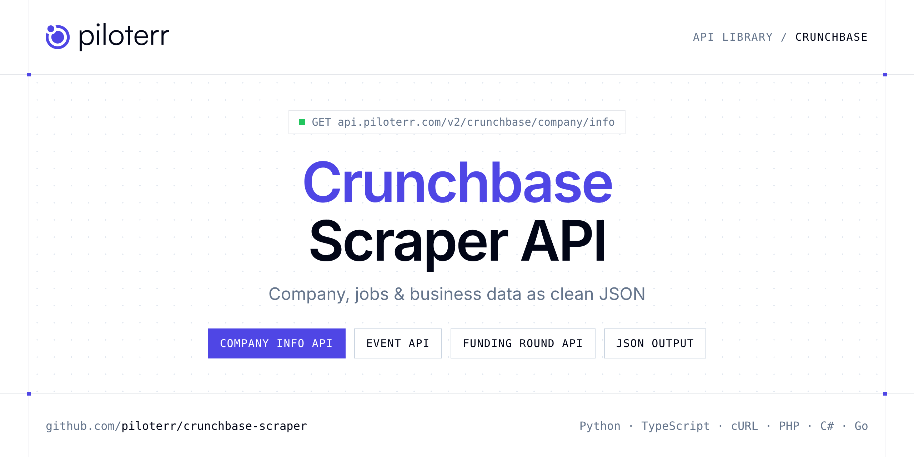

<p align="center">
  <a href="https://www.piloterr.com"></a>
</p>

# Crunchbase Scraper API

[](https://discord.gg/CFj3ph8aHU) [](https://app.piloterr.com) [](https://app.piloterr.com/openapi) [](LICENSE)

The **Piloterr Crunchbase Scraper API** lets you extract public data from Crunchbase as **clean, structured JSON** — no proxies, headless browsers or HTML parsing to maintain. Endpoints available in production:

- **Crunchbase Company Info API** — Convert URLs into detailed Crunchbase profiles for immediate company insights.
- **Crunchbase Event API** — Retrieve detailed Crunchbase event profiles with speakers, sponsors, exhibitors, and press timelines.
- **Crunchbase Funding Round API** — Retrieve full details of a specific Crunchbase funding round including investors and press timeline.
- **Crunchbase Funding Rounds API** — Monitor funding history and financial milestones of companies with Crunchbase data.
- **Crunchbase People Info API** — Retrieve detailed Crunchbase profiles for individuals including career history, investments, and board positions.
- **Crunchbase Search API** — Search Crunchbase for companies and people by keyword and retrieve their profiles and Crunchbase identifiers.

Use it for lead generation, CRM enrichment, market mapping, investment research or job market analytics.

| Endpoint | Path | Credits | What you get |
|---|---|---|---|
| [Crunchbase Company Info API](#crunchbase-company-info-api) | `/v2/crunchbase/company/info` | 2 | Convert URLs into detailed Crunchbase profiles for immediate company insights. |
| [Crunchbase Event API](#crunchbase-event-api) | `/v2/crunchbase/event` | 2 | Retrieve detailed Crunchbase event profiles with speakers, sponsors, exhibitors, and press timelines. |
| [Crunchbase Funding Round API](#crunchbase-funding-round-api) | `/v2/crunchbase/funding_round` | 2 | Retrieve full details of a specific Crunchbase funding round including investors and press timeline. |
| [Crunchbase Funding Rounds API](#crunchbase-funding-rounds-api) | `/v2/crunchbase/funding_rounds` | 2 | Monitor funding history and financial milestones of companies with Crunchbase data. |
| [Crunchbase People Info API](#crunchbase-people-info-api) | `/v2/crunchbase/people/info` | 2 | Retrieve detailed Crunchbase profiles for individuals including career history, investments, and board positions. |
| [Crunchbase Search API](#crunchbase-search-api) | `/v2/crunchbase/search` | 2 | Search Crunchbase for companies and people by keyword and retrieve their profiles and Crunchbase identifiers. |

## Table of contents

- [How it works](#how-it-works)
- [Crunchbase Company Info API](#crunchbase-company-info-api)
- [Crunchbase Event API](#crunchbase-event-api)
- [Crunchbase Funding Round API](#crunchbase-funding-round-api)
- [Crunchbase Funding Rounds API](#crunchbase-funding-rounds-api)
- [Crunchbase People Info API](#crunchbase-people-info-api)
- [Crunchbase Search API](#crunchbase-search-api)
- [Code examples in other languages](#code-examples-in-other-languages)
- [Practical use cases](#practical-use-cases)
- [Why Piloterr?](#why-piloterr)
- [FAQ](#faq)
- [Related scrapers](#related-scrapers)
- [Support](#support)

## How it works

1. **Create a free Piloterr account** and copy your API key from the [dashboard](https://app.piloterr.com).
2. **Send a `GET` (or `POST`) request** to `https://api.piloterr.com/v2/...` with the header `x-api-key: YOUR_API_KEY`.
3. **Receive structured JSON** — Piloterr handles rendering, proxies, retries and parsing.

```bash
export PILOTERR_API_KEY="your-api-key"
pip install requests        # Python
# TypeScript: Node.js 18+ (native fetch), run with `npx tsx file.ts`
```

> Every endpoint accepts both `GET` (query string) and `POST` (JSON body with the same fields).

## Crunchbase Company Info API

Convert URLs into detailed Crunchbase profiles for immediate company insights.

`GET | POST https://api.piloterr.com/v2/crunchbase/company/info` · **2 credits per request** · [Full reference](https://app.piloterr.com/openapi)

### Request parameters

| Parameter | Type | Required | Description |
|---|---|---|---|
| `query` | string | — | Search for a company by its name, permalink, or full Crunchbase URL. |
| `domain` | string | — | Perform a reverse lookup by domain name to find the associated Crunchbase company profile. |

### Python example

```python
import json
import os
import requests

response = requests.get(
    "https://api.piloterr.com/v2/crunchbase/company/info",
    headers={"x-api-key": os.environ["PILOTERR_API_KEY"]},
    params={
        "query": "openai",
    },
    timeout=60,
)
response.raise_for_status()
data = response.json()

print(json.dumps(data, indent=2, ensure_ascii=False)[:2000])
```

### TypeScript example

```typescript
type CrunchbaseCompanyInfo = {
  logo?: string;
  name?: string;
  tags?: string[];
  uuid?: string;
  aliases?: string[];
  founded?: string;
  website?: string;
  headline?: string;
  location?: {
    name?: string;
    type?: string;
    uuid?: string;
    permalink?: string;
  }[];
  permalink?: string;
  categories?: {
    name?: string;
    uuid?: string;
    permalink?: string;
  }[];
  description?: string;
  company_type?: string;
  phone_number?: string;
  employee_count?: string;
  semrush_summary?: {
    semrush_global_rank?: number;
    semrush_visits_latest_month?: number;
  };
  social_networks?: {
    url?: string;
    name?: string;
  }[];
  operating_status?: string;
  funding_rounds_headline?: {
    funding_total?: {
      value?: number;
      currency?: string;
      value_usd?: number;
    };
    num_funding_rounds?: number;
  };
  company_financials_highlights?: {
    num_exits?: number;
    num_funds?: number;
    funding_total?: {
      value?: number;
      currency?: string;
      value_usd?: number;
    };
    num_investors?: number;
    num_investments?: number;
    num_funding_rounds?: number;
    num_lead_investors?: number;
    num_lead_investments?: number;
  };
};

const params = new URLSearchParams({
  "query": "openai",
});

const response = await fetch(`https://api.piloterr.com/v2/crunchbase/company/info?${params}`, {
  headers: { "x-api-key": process.env.PILOTERR_API_KEY! },
});
if (!response.ok) throw new Error(`Piloterr error ${response.status}: ${await response.text()}`);

const data = (await response.json()) as CrunchbaseCompanyInfo;

console.log(JSON.stringify(data, null, 2).slice(0, 2000));
```

<details>
<summary><b>POST variant</b></summary>

```http
POST https://api.piloterr.com/v2/crunchbase/company/info
x-api-key: YOUR_API_KEY
Content-Type: application/json

{"query": "openai"}
```
</details>

### Output example

Example response from the API reference, abridged — real values depend on the page you scrape.

```json
{
  "logo": "https://images.crunchbase.com/image/upload/c_pad,h_45,w_45,f_auto,b_white,q_auto:eco,dpr_1/jjykwqqhsscreywea4gb",
  "name": "OpenAI",
  "tags": [
    "unicorn"
  ],
  "uuid": "cf2c678c-b81a-80c3-10d1-9c5e76448e51",
  "aliases": [
    "OpenAI LP"
  ],
  "founded": "2015-12-11",
  "website": "https://www.openai.com",
  "headline": "OpenAI creates artificial intelligence technologies to assist with tasks and provide support for human activities.",
  "location": [
    {
      "name": "San Francisco",
      "type": "city",
      "uuid": "528f5e3c-90d1-1111-5d1c-2e4ff979d58e",
      "permalink": "san-francisco-california"
    },
    {
      "name": "California",
      "type": "region",
      "uuid": "eb879a83-c91a-121e-0bb8-829782dbcf04",
      "permalink": "california-united-states"
    }
  ],
  "permalink": "openai",
  "categories": [
    {
      "name": "Artificial Intelligence (AI)",
      "uuid": "c4d8caf3-5fe7-359b-f9f2-2d708378e4ee",
      "permalink": "artificial-intelligence"
    },
    {
      "name": "Generative AI",
      "uuid": "8314a534-8f18-4ee0-869b-05bc6e46258e",
      "permalink": "generative-ai"
    }
  ],
  "description": "OpenAI is an AI research and deployment company that conducts research and develops machine learning technologies.",
  "company_type": "for profit",
  "phone_number": "example",
  "employee_count": "251-500",
  "semrush_summary": {
    "semrush_global_rank": 30,
    "semrush_visits_latest_month": 1478777166
  },
  "social_networks": [
    {
      "url": "https://www.facebook.com/openai",
      "name": "facebook"
    },
    {
      "url": "https://www.linkedin.com/company/openai",
      "name": "linkedin"
    }
  ],
  "operating_status": "active",
  "funding_rounds_headline": {
    "funding_total": {
      "value": 21900120000,
      "currency": "USD",
      "value_usd": 21900120000
    },
    "num_funding_rounds": 10
  },
  "company_financials_highlights": {
    "num_exits": 1,
    "num_funds": 1,
    "funding_total": {
      "value": 21900120000,
      "currency": "USD",
      "value_usd": 21900120000
    },
    "num_investors": 39,
    "num_investments": 16,
    "num_funding_rounds": 10,
    "num_lead_investors": 9,
    "num_lead_investments": 6
  }
}
```

### Response fields

| Field | Type | Description |
|---|---|---|
| `logo` | string |  |
| `name` | string |  |
| `tags` | string[] |  |
| `uuid` | string |  |
| `aliases` | string[] |  |
| `founded` | string |  |
| `website` | string |  |
| `headline` | string |  |
| `location[]` | object[] |  |
| `location[].name` | string |  |
| `location[].type` | string |  |
| `location[].uuid` | string |  |
| `location[].permalink` | string |  |
| `permalink` | string |  |
| `categories[]` | object[] |  |
| `categories[].name` | string |  |
| `categories[].uuid` | string |  |
| `categories[].permalink` | string |  |
| `description` | string |  |
| `company_type` | string |  |
| `phone_number` | string |  |
| `employee_count` | string |  |
| `semrush_summary` | object |  |
| `semrush_summary.semrush_global_rank` | integer |  |
| `semrush_summary.semrush_visits_latest_month` | integer |  |

## Crunchbase Event API

Retrieve detailed Crunchbase event profiles with speakers, sponsors, exhibitors, and press timelines.

`GET | POST https://api.piloterr.com/v2/crunchbase/event` · **2 credits per request** · [Full reference](https://app.piloterr.com/openapi)

### Request parameters

| Parameter | Type | Required | Description |
|---|---|---|---|
| `query` | string | ✅ | Retrieve event data using its Crunchbase permalink or full URL. |

### Python example

```python
import json
import os
import requests

response = requests.get(
    "https://api.piloterr.com/v2/crunchbase/event",
    headers={"x-api-key": os.environ["PILOTERR_API_KEY"]},
    params={
        "query": "london-tech-week-2025",
    },
    timeout=60,
)
response.raise_for_status()
data = response.json()

print(json.dumps(data, indent=2, ensure_ascii=False)[:2000])
```

### TypeScript example

```typescript
type CrunchbaseEvent = {
  logo?: string;
  name?: string;
  uuid?: string;
  title?: string;
  ends_on?: string;
  speakers?: {
    logo?: string;
    name?: string;
    uuid?: string;
    job_title?: string;
    permalink?: string;
    organization?: {
      logo?: string;
      name?: string;
      uuid?: string;
      permalink?: string;
    };
  }[];
  sponsors?: {
    logo?: string;
    name?: string;
    uuid?: string;
    permalink?: string;
    short_description?: string;
  }[];
  timeline?: {
    count?: number;
    events?: {
      url?: string;
      date?: string;
      type?: string;
      uuid?: string;
      title?: string;
      publisher?: string;
    }[];
  };
  is_locked?: boolean;
  starts_on?: string;
  categories?: {
    name?: string;
    uuid?: string;
    image_id?: string;
    permalink?: string;
  }[];
  event_type?: string[];
  description?: string;
  num_speakers?: number;
  num_sponsors?: number;
  num_exhibitors?: number;
  num_contestants?: number;
  registration_url?: string;
  short_description?: string;
};

const params = new URLSearchParams({
  "query": "london-tech-week-2025",
});

const response = await fetch(`https://api.piloterr.com/v2/crunchbase/event?${params}`, {
  headers: { "x-api-key": process.env.PILOTERR_API_KEY! },
});
if (!response.ok) throw new Error(`Piloterr error ${response.status}: ${await response.text()}`);

const data = (await response.json()) as CrunchbaseEvent;

console.log(JSON.stringify(data, null, 2).slice(0, 2000));
```

<details>
<summary><b>POST variant</b></summary>

```http
POST https://api.piloterr.com/v2/crunchbase/event
x-api-key: YOUR_API_KEY
Content-Type: application/json

{"query": "london-tech-week-2025"}
```
</details>

### Output example

Example response from the API reference, abridged — real values depend on the page you scrape.

```json
{
  "logo": "https://images.crunchbase.com/image/upload/c_pad,h_45,w_45,f_auto,b_white,q_auto:eco,dpr_1/9aa88663aa2d40f9a88ecdc8952592b3",
  "name": "London Tech Week 2025",
  "uuid": "6f8c7989-7470-4ea4-acd0-5aae0f1706bb",
  "title": "London Tech Week 2025 - 2025-06-09",
  "ends_on": "2025-06-13",
  "speakers": [
    {
      "logo": "https://images.crunchbase.com/image/upload/c_pad,h_45,w_45,f_auto,b_white,q_auto:eco,dpr_1/rrzznkdyojhlcd3lvkvm",
      "name": "Abadesi Osunsade",
      "uuid": "517741a8-49d2-4ea5-9a8f-1da0f4467c5f",
      "job_title": "Founder & CEO",
      "permalink": "abadesi-osunsade",
      "organization": {
        "logo": "https://images.crunchbase.com/image/upload/c_pad,h_45,w_45,f_auto,b_white,q_auto:eco,dpr_1/bslkx7akyoomhhdkgalx",
        "name": "Hustle Crew",
        "uuid": "20071392-22fe-41e9-8bdf-b5301983183a",
        "permalink": "hustle-crew"
      }
    }
  ],
  "sponsors": [
    {
      "logo": "https://images.crunchbase.com/image/upload/c_pad,h_45,w_45,f_auto,b_white,q_auto:eco,dpr_1/r4wsu8rl4jvpjydbhooy",
      "name": "Amazon Web Services",
      "uuid": "bd23a50d-2ae3-be33-2a35-383ea9ed13fd",
      "permalink": "amazon-web-services",
      "short_description": "Amazon Web Services provides information technology infrastructure services to businesses in the form of web services."
    },
    {
      "logo": "https://images.crunchbase.com/image/upload/c_pad,h_45,w_45,f_auto,b_white,q_auto:eco,dpr_1/qelsdny4aknixldgwzlr",
      "name": "Cisco",
      "uuid": "e0906c05-fae5-9591-ba5f-2142d8b0065a",
      "permalink": "cisco",
      "short_description": "Cisco develops, manufactures, and sells networking hardware, telecommunications equipment, and other technology services."
    }
  ],
  "timeline": {
    "count": 2,
    "events": [
      {
        "url": "https://www.linkedin.com/feed/update/urn:li:activity:7338585172994334724",
        "date": "2025-06-12",
        "type": "press_reference",
        "uuid": "b684dacf-c342-4369-b996-899d33216892",
        "title": "London Tech Week 2025: Bexprt selected to showcase their genAI solutions",
        "publisher": "linkedin.com"
      }
    ]
  },
  "is_locked": true,
  "starts_on": "2025-06-09",
  "categories": [
    {
      "name": "Business Development",
      "uuid": "1fe278ea-e441-01b9-30db-6c301c0d6fd1",
      "image_id": "a7ae45fd9f1e4a0fa80d91eac6964977",
      "permalink": "business-development"
    },
    {
      "name": "Events",
      "uuid": "d4a7bfe6-59ed-ae17-e043-1a7415745a0e",
      "image_id": "4935543a82d34d6f82df08a74c1751f4",
      "permalink": "events"
    }
  ],
  "event_type": [
    "conference",
    "demo_day"
  ],
  "description": "London Tech Week 2025 is a technology festival that convenes innovators, investors, and enterprise leaders to explore advancements in are…",
  "num_speakers": 386,
  "num_sponsors": 12,
  "num_exhibitors": 6,
  "num_contestants": 1,
  "registration_url": "https://londontechweek.com/exhibitor-list/nearswipe",
  "short_description": "London Tech Week 2025 is a technology festival that convenes innovators, investors, and enterprise leaders."
}
```

### Response fields

| Field | Type | Description |
|---|---|---|
| `logo` | string |  |
| `name` | string |  |
| `uuid` | string |  |
| `title` | string |  |
| `ends_on` | string |  |
| `speakers[]` | object[] |  |
| `speakers[].logo` | string |  |
| `speakers[].name` | string |  |
| `speakers[].uuid` | string |  |
| `speakers[].job_title` | string |  |
| `speakers[].permalink` | string |  |
| `speakers[].organization` | object |  |
| `sponsors[]` | object[] |  |
| `sponsors[].logo` | string |  |
| `sponsors[].name` | string |  |
| `sponsors[].uuid` | string |  |
| `sponsors[].permalink` | string |  |
| `sponsors[].short_description` | string |  |
| `timeline` | object |  |
| `timeline.count` | integer |  |
| `timeline.events[]` | object[] |  |
| `is_locked` | boolean |  |
| `starts_on` | string |  |
| `categories[]` | object[] |  |
| `categories[].name` | string |  |

## Crunchbase Funding Round API

Retrieve full details of a specific Crunchbase funding round including investors and press timeline.

`GET | POST https://api.piloterr.com/v2/crunchbase/funding_round` · **2 credits per request** · [Full reference](https://app.piloterr.com/openapi)

### Request parameters

| Parameter | Type | Required | Description |
|---|---|---|---|
| `query` | string | ✅ | The permalink of the specific funding round to retrieve. This is the unique identifier found in the Crunchbase funding round URL. |

### Python example

```python
import json
import os
import requests

response = requests.get(
    "https://api.piloterr.com/v2/crunchbase/funding_round",
    headers={"x-api-key": os.environ["PILOTERR_API_KEY"]},
    params={
        "query": "openai-secondary-market--3bab6e98",
    },
    timeout=60,
)
response.raise_for_status()
data = response.json()

print(json.dumps(data, indent=2, ensure_ascii=False)[:2000])
```

### TypeScript example

```typescript
type CrunchbaseFundingRound = {
  uuid?: string;
  cards?: {
    timeline?: {
      count?: number;
      entities?: Record<string, unknown>[];
    };
    investors_list?: {
      identifier?: Record<string, unknown>;
      investor_identifier?: Record<string, unknown>;
    }[];
    investors_headline?: {
      num_investors?: number;
    };
    lead_investors_image_list?: unknown[];
  };
  value?: string;
  image_id?: string;
  permalink?: string;
  entity_def_id?: string;
  num_investors?: number;
  overview_fields_v2?: {
    investment_type?: string;
    preview_properties?: {
      announced_on?: Record<string, unknown>;
      money_raised?: Record<string, unknown>;
    };
    funded_organization_identifier?: {
      role?: string;
      uuid?: string;
      value?: string;
      image_id?: string;
      permalink?: string;
      entity_def_id?: string;
    };
  };
};

const params = new URLSearchParams({
  "query": "openai-secondary-market--3bab6e98",
});

const response = await fetch(`https://api.piloterr.com/v2/crunchbase/funding_round?${params}`, {
  headers: { "x-api-key": process.env.PILOTERR_API_KEY! },
});
if (!response.ok) throw new Error(`Piloterr error ${response.status}: ${await response.text()}`);

const data = (await response.json()) as CrunchbaseFundingRound;

console.log(JSON.stringify(data, null, 2).slice(0, 2000));
```

<details>
<summary><b>POST variant</b></summary>

```http
POST https://api.piloterr.com/v2/crunchbase/funding_round
x-api-key: YOUR_API_KEY
Content-Type: application/json

{"query": "openai-secondary-market--3bab6e98"}
```
</details>

### Output example

Example response from the API reference, abridged — real values depend on the page you scrape.

```json
{
  "uuid": "3bab6e98-2db3-4803-ba85-579ff21b81dd",
  "cards": {
    "timeline": {
      "count": 44,
      "entities": [
        {},
        {}
      ]
    },
    "investors_list": [
      {
        "identifier": {},
        "investor_identifier": {}
      },
      {
        "identifier": {},
        "investor_identifier": {}
      }
    ],
    "investors_headline": {
      "num_investors": 6
    },
    "lead_investors_image_list": []
  },
  "value": "Secondary Market - OpenAI",
  "image_id": "jjykwqqhsscreywea4gb",
  "permalink": "openai-secondary-market--3bab6e98",
  "entity_def_id": "funding_round",
  "num_investors": 6,
  "overview_fields_v2": {
    "investment_type": "secondary_market",
    "preview_properties": {
      "announced_on": {
        "is_present": true
      },
      "money_raised": {
        "is_present": true
      }
    },
    "funded_organization_identifier": {
      "role": "investee",
      "uuid": "cf2c678c-b81a-80c3-10d1-9c5e76448e51",
      "value": "OpenAI",
      "image_id": "jjykwqqhsscreywea4gb",
      "permalink": "openai",
      "entity_def_id": "organization"
    }
  }
}
```

### Response fields

| Field | Type | Description |
|---|---|---|
| `uuid` | string |  |
| `cards` | object |  |
| `cards.timeline` | object |  |
| `cards.investors_list[]` | object[] |  |
| `cards.investors_headline` | object |  |
| `cards.lead_investors_image_list` | any[] |  |
| `value` | string |  |
| `image_id` | string |  |
| `permalink` | string |  |
| `entity_def_id` | string |  |
| `num_investors` | integer |  |
| `overview_fields_v2` | object |  |
| `overview_fields_v2.investment_type` | string |  |
| `overview_fields_v2.preview_properties` | object |  |
| `overview_fields_v2.funded_organization_identifier` | object |  |

## Crunchbase Funding Rounds API

Monitor funding history and financial milestones of companies with Crunchbase data.

`GET | POST https://api.piloterr.com/v2/crunchbase/funding_rounds` · **2 credits per request** · [Full reference](https://app.piloterr.com/openapi)

### Request parameters

| Parameter | Type | Required | Description |
|---|---|---|---|
| `days_since_announcement` | number | — | Filter funding rounds announced within the last N days. |
| `investment_type` | string | — | Filter by funding round type. Accepted values: |
| `investor_identifiers` | string | — | Filter rounds by a specific investor using their Crunchbase UUID. |
| `funded_organization_identifier` | string | — | Filter rounds by a specific funded organization using their Crunchbase UUID. |

### Python example

```python
import json
import os
import requests

response = requests.get(
    "https://api.piloterr.com/v2/crunchbase/funding_rounds",
    headers={"x-api-key": os.environ["PILOTERR_API_KEY"]},
    params={
        "days_since_announcement": "30",
    },
    timeout=60,
)
response.raise_for_status()
data = response.json()

print(json.dumps(data, indent=2, ensure_ascii=False)[:2000])
```

### TypeScript example

```typescript
type CrunchbaseFundingRounds = {
  total?: number;
  results?: {
    uuid?: string;
    identifier?: {
      uuid?: string;
      value?: string;
      image_id?: string;
      permalink?: string;
      entity_def_id?: string;
    };
    investment_type?: string;
    investor_identifiers?: unknown[];
    funded_organization_identifier?: {
      role?: string;
      uuid?: string;
      value?: string;
      image_id?: string;
      permalink?: string;
      entity_def_id?: string;
    };
  }[];
};

const params = new URLSearchParams({
  "days_since_announcement": "30",
});

const response = await fetch(`https://api.piloterr.com/v2/crunchbase/funding_rounds?${params}`, {
  headers: { "x-api-key": process.env.PILOTERR_API_KEY! },
});
if (!response.ok) throw new Error(`Piloterr error ${response.status}: ${await response.text()}`);

const data = (await response.json()) as CrunchbaseFundingRounds;

console.log(JSON.stringify(data, null, 2).slice(0, 2000));
```

<details>
<summary><b>POST variant</b></summary>

```http
POST https://api.piloterr.com/v2/crunchbase/funding_rounds
x-api-key: YOUR_API_KEY
Content-Type: application/json

{"days_since_announcement": "30"}
```
</details>

### Output example

Example response from the API reference, abridged — real values depend on the page you scrape.

```json
{
  "total": 158,
  "results": [
    {
      "uuid": "2ede9c7b-6c12-4a08-bf5b-92c9ec71a740",
      "identifier": {
        "uuid": "2ede9c7b-6c12-4a08-bf5b-92c9ec71a740",
        "value": "Series D - Qcraft",
        "image_id": "giqfjoidpupjjihprsr8",
        "permalink": "qcraft-7238-series-d--2ede9c7b",
        "entity_def_id": "funding_round"
      },
      "investment_type": "series_d",
      "investor_identifiers": [],
      "funded_organization_identifier": {
        "role": "investee",
        "uuid": "18882feb-84bc-4ece-992e-facf1c857238",
        "value": "Qcraft",
        "image_id": "giqfjoidpupjjihprsr8",
        "permalink": "qcraft-7238",
        "entity_def_id": "organization"
      }
    },
    {
      "uuid": "ea87f4f8-fa9d-4f21-a770-47d97bb10281",
      "identifier": {
        "uuid": "ea87f4f8-fa9d-4f21-a770-47d97bb10281",
        "value": "Series A - BlueFlag Security",
        "image_id": "b1b8397367e84608a38d52eba59de6c7",
        "permalink": "blueflag-security-series-a--ea87f4f8",
        "entity_def_id": "funding_round"
      },
      "investment_type": "series_a",
      "investor_identifiers": [],
      "funded_organization_identifier": {
        "role": "investee",
        "uuid": "d5db2cf1-197b-44d2-b214-7eb0db399586",
        "value": "BlueFlag Security",
        "image_id": "b1b8397367e84608a38d52eba59de6c7",
        "permalink": "blueflag-security",
        "entity_def_id": "organization"
      }
    }
  ]
}
```

### Response fields

| Field | Type | Description |
|---|---|---|
| `total` | integer |  |
| `results[]` | object[] |  |
| `results[].uuid` | string |  |
| `results[].identifier` | object |  |
| `results[].investment_type` | string |  |
| `results[].investor_identifiers` | any[] |  |
| `results[].funded_organization_identifier` | object |  |

## Crunchbase People Info API

Retrieve detailed Crunchbase profiles for individuals including career history, investments, and board positions.

`GET | POST https://api.piloterr.com/v2/crunchbase/people/info` · **2 credits per request** · [Full reference](https://app.piloterr.com/openapi)

### Request parameters

| Parameter | Type | Required | Description |
|---|---|---|---|
| `query` | string | ✅ | Search for a person by their name, Crunchbase permalink, or full Crunchbase profile URL. |

### Python example

```python
import json
import os
import requests

response = requests.get(
    "https://api.piloterr.com/v2/crunchbase/people/info",
    headers={"x-api-key": os.environ["PILOTERR_API_KEY"]},
    params={
        "query": "elon-musk",
    },
    timeout=60,
)
response.raise_for_status()
data = response.json()

print(json.dumps(data, indent=2, ensure_ascii=False)[:2000])
```

### TypeScript example

```typescript
type CrunchbasePeopleInfo = {
  logo?: string;
  name?: string;
  uuid?: string;
  title?: string;
  gender?: string;
  image_id?: string;
  education?: {
    school?: {
      logo?: string;
      name?: string;
      uuid?: string;
      permalink?: string;
    };
    started_on?: unknown;
    degree_name?: unknown;
    completed_on?: unknown;
    education_uuid?: string;
  }[];
  facet_ids?: string[];
  locations?: {
    name?: string;
    type?: string;
    uuid?: string;
    permalink?: string;
  }[];
  permalink?: string;
  investments?: unknown[];
  past_positions?: {
    title?: string;
    ended_on?: {
      value?: string;
      precision?: string;
    };
    job_uuid?: string;
    started_on?: {
      value?: string;
      precision?: string;
    };
    organization?: {
      name?: string;
      uuid?: string;
      permalink?: string;
    };
  }[];
  social_networks?: {
    url?: string;
    name?: string;
  }[];
  num_current_jobs?: number;
  current_positions?: {
    title?: string;
    job_uuid?: string;
    organization?: {
      logo?: string;
      name?: string;
      uuid?: string;
      permalink?: string;
    };
  }[];
  short_description?: string;
  rank_principal_investor?: number;
  num_founded_organizations?: number;
};

const params = new URLSearchParams({
  "query": "elon-musk",
});

const response = await fetch(`https://api.piloterr.com/v2/crunchbase/people/info?${params}`, {
  headers: { "x-api-key": process.env.PILOTERR_API_KEY! },
});
if (!response.ok) throw new Error(`Piloterr error ${response.status}: ${await response.text()}`);

const data = (await response.json()) as CrunchbasePeopleInfo;

console.log(JSON.stringify(data, null, 2).slice(0, 2000));
```

<details>
<summary><b>POST variant</b></summary>

```http
POST https://api.piloterr.com/v2/crunchbase/people/info
x-api-key: YOUR_API_KEY
Content-Type: application/json

{"query": "elon-musk"}
```
</details>

### Output example

Response shape with placeholder values — field names follow the API reference.

```json
{
  "logo": "example",
  "name": "example",
  "uuid": "example",
  "title": "example",
  "gender": "example",
  "image_id": "example",
  "education": [
    {
      "school": {},
      "started_on": "example",
      "degree_name": "example",
      "completed_on": "example",
      "education_uuid": "example"
    }
  ],
  "facet_ids": [
    "example"
  ],
  "locations": [
    {
      "name": "example",
      "type": "example",
      "uuid": "example",
      "permalink": "example"
    }
  ],
  "permalink": "example",
  "investments": [
    "example"
  ],
  "past_positions": [
    {
      "title": "example",
      "ended_on": {},
      "job_uuid": "example",
      "started_on": {},
      "organization": {}
    }
  ],
  "social_networks": [
    {
      "url": "example",
      "name": "example"
    }
  ],
  "num_current_jobs": 0,
  "current_positions": [
    {
      "title": "example",
      "job_uuid": "example",
      "organization": {}
    }
  ],
  "short_description": "example",
  "rank_principal_investor": 0,
  "num_founded_organizations": 0
}
```

### Response fields

| Field | Type | Description |
|---|---|---|
| `logo` | string |  |
| `name` | string |  |
| `uuid` | string |  |
| `title` | string |  |
| `gender` | string |  |
| `image_id` | string |  |
| `education[]` | object[] |  |
| `education[].school` | object |  |
| `education[].started_on` | object |  |
| `education[].degree_name` | object |  |
| `education[].completed_on` | object |  |
| `education[].education_uuid` | string |  |
| `facet_ids` | string[] |  |
| `locations[]` | object[] |  |
| `locations[].name` | string |  |
| `locations[].type` | string |  |
| `locations[].uuid` | string |  |
| `locations[].permalink` | string |  |
| `permalink` | string |  |
| `investments` | any[] |  |
| `past_positions[]` | object[] |  |
| `past_positions[].title` | string |  |
| `past_positions[].ended_on` | object |  |
| `past_positions[].job_uuid` | string |  |
| `past_positions[].started_on` | object |  |

## Crunchbase Search API

Search Crunchbase for companies and people by keyword and retrieve their profiles and Crunchbase identifiers.

`GET | POST https://api.piloterr.com/v2/crunchbase/search` · **2 credits per request** · [Full reference](https://app.piloterr.com/openapi)

### Request parameters

| Parameter | Type | Required | Description |
|---|---|---|---|
| `query` | string | ✅ | The search keyword or phrase to query across Crunchbase. Searches both organizations and people. |

### Python example

```python
import json
import os
import requests

response = requests.get(
    "https://api.piloterr.com/v2/crunchbase/search",
    headers={"x-api-key": os.environ["PILOTERR_API_KEY"]},
    params={
        "query": "openai",
    },
    timeout=60,
)
response.raise_for_status()
data = response.json()

print(json.dumps(data, indent=2, ensure_ascii=False)[:2000])
```

### TypeScript example

```typescript
type CrunchbaseSearch = {
  results?: {
    logo?: string;
    name?: string;
    type?: string;
    uuid?: string;
    image_id?: string;
    permalink?: string;
    description?: string;
  }[];
};

const params = new URLSearchParams({
  "query": "openai",
});

const response = await fetch(`https://api.piloterr.com/v2/crunchbase/search?${params}`, {
  headers: { "x-api-key": process.env.PILOTERR_API_KEY! },
});
if (!response.ok) throw new Error(`Piloterr error ${response.status}: ${await response.text()}`);

const data = (await response.json()) as CrunchbaseSearch;

console.log(JSON.stringify(data, null, 2).slice(0, 2000));
```

<details>
<summary><b>POST variant</b></summary>

```http
POST https://api.piloterr.com/v2/crunchbase/search
x-api-key: YOUR_API_KEY
Content-Type: application/json

{"query": "openai"}
```
</details>

### Output example

Example response from the API reference, abridged — real values depend on the page you scrape.

```json
{
  "results": [
    {
      "logo": "https://images.crunchbase.com/image/upload/c_pad,h_45,w_45,f_auto,b_white,q_auto:eco,dpr_1/jjykwqqhsscreywea4gb",
      "name": "OpenAI",
      "type": "organization",
      "uuid": "cf2c678c-b81a-80c3-10d1-9c5e76448e51",
      "image_id": "jjykwqqhsscreywea4gb",
      "permalink": "openai",
      "description": "OpenAI is an AI research and deployment company that develops advanced AI models, including ChatGPT."
    },
    {
      "logo": "https://images.crunchbase.com/image/upload/c_pad,h_45,w_45,f_auto,b_white,q_auto:eco,dpr_1/zrafm9hariyl22gfnzkq",
      "name": "OpenAi",
      "type": "organization",
      "uuid": "30658435-66e6-4d4a-bcce-5ac474713ef1",
      "image_id": "zrafm9hariyl22gfnzkq",
      "permalink": "openai-3ef1",
      "description": "OpenAi provides solutions for artificial intelligence and social media management."
    }
  ]
}
```

### Response fields

| Field | Type | Description |
|---|---|---|
| `results[]` | object[] |  |
| `results[].logo` | string |  |
| `results[].name` | string |  |
| `results[].type` | string |  |
| `results[].uuid` | string |  |
| `results[].image_id` | string |  |
| `results[].permalink` | string |  |
| `results[].description` | string |  |

## Code examples in other languages

Ready-to-run examples live in the [`examples/`](examples) folder. Each one reads your key from the `PILOTERR_API_KEY` environment variable.

| Language | Company Info | Event | Funding Round | Funding Rounds | People Info | Search |
|---|---|---|---|---|---|---|
| cURL (Bash) | [`company-info`](examples/curl/company_info.sh) | [`event`](examples/curl/event.sh) | [`funding-round`](examples/curl/funding_round.sh) | [`funding-rounds`](examples/curl/funding_rounds.sh) | [`people-info`](examples/curl/people_info.sh) | [`search`](examples/curl/search.sh) |
| PHP | [`company-info`](examples/php/company_info.php) | [`event`](examples/php/event.php) | [`funding-round`](examples/php/funding_round.php) | [`funding-rounds`](examples/php/funding_rounds.php) | [`people-info`](examples/php/people_info.php) | [`search`](examples/php/search.php) |
| C# | [`company-info`](examples/csharp/CompanyInfo.cs) | [`event`](examples/csharp/Event.cs) | [`funding-round`](examples/csharp/FundingRound.cs) | [`funding-rounds`](examples/csharp/FundingRounds.cs) | [`people-info`](examples/csharp/PeopleInfo.cs) | [`search`](examples/csharp/Search.cs) |
| Go | [`company-info`](examples/go/company_info.go) | [`event`](examples/go/event.go) | [`funding-round`](examples/go/funding_round.go) | [`funding-rounds`](examples/go/funding_rounds.go) | [`people-info`](examples/go/people_info.go) | [`search`](examples/go/search.go) |
| Java | [`company-info`](examples/java/CompanyInfoExample.java) | [`event`](examples/java/EventExample.java) | [`funding-round`](examples/java/FundingRoundExample.java) | [`funding-rounds`](examples/java/FundingRoundsExample.java) | [`people-info`](examples/java/PeopleInfoExample.java) | [`search`](examples/java/SearchExample.java) |
| Ruby | [`company-info`](examples/ruby/company_info.rb) | [`event`](examples/ruby/event.rb) | [`funding-round`](examples/ruby/funding_round.rb) | [`funding-rounds`](examples/ruby/funding_rounds.rb) | [`people-info`](examples/ruby/people_info.rb) | [`search`](examples/ruby/search.rb) |
| Node.js | [`company-info`](examples/nodejs/company_info.mjs) | [`event`](examples/nodejs/event.mjs) | [`funding-round`](examples/nodejs/funding_round.mjs) | [`funding-rounds`](examples/nodejs/funding_rounds.mjs) | [`people-info`](examples/nodejs/people_info.mjs) | [`search`](examples/nodejs/search.mjs) |

## Practical use cases

- **Lead generation** — Build target account lists from public company data.
- **CRM enrichment** — Keep firmographics, websites and descriptions up to date.
- **Market mapping** — Map competitors and segments across countries and industries.
- **Investment research** — Screen companies, funding and signals for deal flow.
- **Job market analytics** — Track hiring, roles and salaries where available.

## Why Piloterr?

- **No infrastructure** — no proxies, headless browsers or CAPTCHA solving to run yourself.
- **Structured JSON** — stable, documented fields instead of brittle HTML selectors.
- **Pay per request** — transparent credit cost per endpoint, failed requests are retried for you.
- **One API key, hundreds of sources** — Crunchbase plus many other e-commerce, search and company data endpoints in the [Piloterr library](https://www.piloterr.com/library).
- **Any language** — plain HTTPS + JSON, with examples for Python, TypeScript, cURL, PHP, C#, Go, Java, Ruby and Node.js.

## FAQ

### Is it legal to scrape Crunchbase?

Collecting publicly available data is generally allowed in many jurisdictions, but rules depend on your country, the data you collect and how you use it. Avoid personal data unless you have a lawful basis, respect the website's terms where they apply, and get legal advice for your specific use case. This is not legal advice.

### Do I need proxies or a headless browser?

No. Piloterr handles rendering, proxy rotation and retries on its side. You only send an HTTPS request with your `x-api-key` header and receive JSON.

### How much does a request cost?

Credits per call: `/v2/crunchbase/company/info` **2**, `/v2/crunchbase/event` **2**, `/v2/crunchbase/funding_round` **2**, `/v2/crunchbase/funding_rounds` **2**, `/v2/crunchbase/people/info` **2**, `/v2/crunchbase/search` **2**. See the [Piloterr website](https://www.piloterr.com) for plans.

### What data does the Crunchbase API return?

Each endpoint returns structured JSON: **Crunchbase Company Info** — `logo`, `name`, `tags`, `uuid`, `aliases`, `founded`; **Crunchbase Event** — `logo`, `name`, `uuid`, `title`, `ends_on`, `speakers[]`; **Crunchbase Funding Round** — `uuid`, `cards`, `cards.timeline`, `cards.investors_list[]`, `cards.investors_headline`, `cards.lead_investors_image_list`; **Crunchbase Funding Rounds** — `total`, `results[]`, `results[].uuid`, `results[].identifier`, `results[].investment_type`, `results[].investor_identifiers`.

### Can I target a specific country or language?

Yes, use `domain` — see the parameter tables above for accepted values.

### Which languages are supported?

Any language that can make an HTTP request. This README shows Python and TypeScript; the [`examples/`](examples) folder contains cURL, PHP, C#, Go, Java, Ruby and Node.js.

## Related scrapers

- [Company Database Scraper API](https://github.com/piloterr/company-data-api)
- [Europages Scraper API](https://github.com/piloterr/europages-scraper)
- [Fiverr Scraper API](https://github.com/piloterr/fiverr-scraper)
- [g2-scraper](https://github.com/piloterr/g2-scraper)
- [github-scraper](https://github.com/piloterr/github-scraper)
- [Glassdoor Scraper API](https://github.com/piloterr/glassdoor-scraper)
- [All Piloterr scrapers on GitHub](https://github.com/piloterr)

## Support

- 💬 Join the [Piloterr Discord](https://discord.gg/CFj3ph8aHU) to ask questions and share what you build.
- 📚 Browse the [API reference (OpenAPI)](https://app.piloterr.com/openapi) and the [Piloterr library](https://www.piloterr.com/library).
- 🔑 [Get your API key](https://app.piloterr.com).

---

<p align="center">
  <a href="https://www.piloterr.com">
    <picture>
      <source media="(prefers-color-scheme: dark)" srcset="images/logo-dark.svg">
      
    </picture>
  </a>
  <br>
  <sub>Built by <a href="https://www.piloterr.com">Piloterr</a> — web scraping APIs for e-commerce, search, real estate and more, one API key.</sub>
</p>

<sub>Crunchbase is a trademark of its respective owner. This repository is not affiliated with or endorsed by Crunchbase. Examples are released under the MIT license.</sub>
